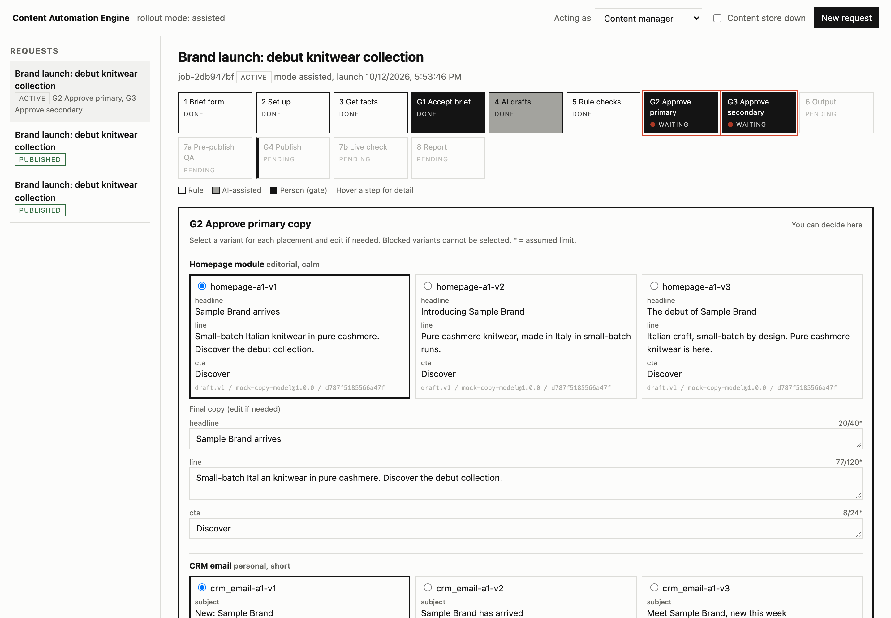
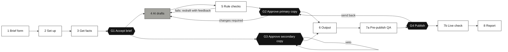
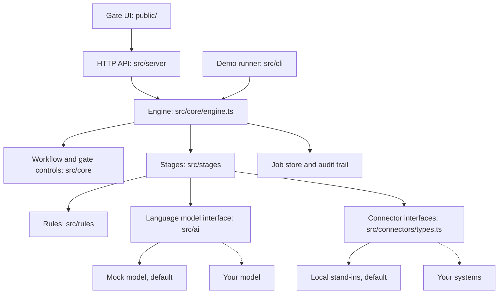
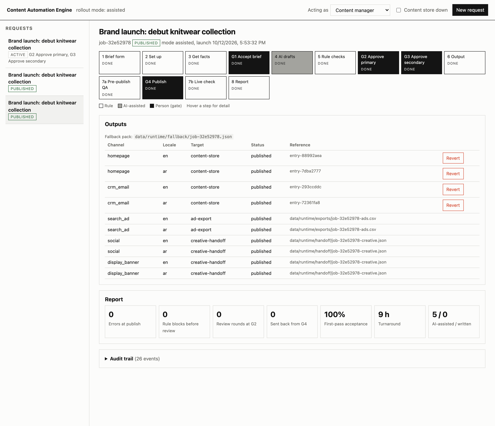

# Content Automation Engine

A reference implementation of a brief-to-publish content workflow. One structured brief becomes on-brand copy for every channel and locale. **Rules check the facts. AI drafts the copy. People approve everything customers see, at four gates.**

It runs on your machine with one command. It needs no external systems, no network and no credentials: every external system sits behind an interface with a local stand-in, and the language model is a deterministic mock. To use it for real, replace the stand-ins with your own adapters. The workflow, the controls and the tests stay the same.



## The rule behind every step

> If a rule can check it, a rule does it. AI drafts where variation is acceptable. A person approves anything a customer sees.

| | Who does it | Examples |
|---|---|---|
| **Rule** | Deterministic code. Cheap, predictable, easy to audit. | Required brief fields, character limits, banned words, material claims, prices, links, layout direction |
| **AI** | A language model, for drafts only. It never types a fact: it writes slots like `{{product.material}}`, which the system fills from approved data. | Three variants for each placement |
| **Person** | Four human gates. Nobody can skip one. | Accept the brief, approve primary copy, approve secondary-locale copy, publish |

The full reasoning is in [docs/decision-model.md](docs/decision-model.md).

## Quick start

Requirements: Node.js 20 or later.

```bash
npm install
npm run demo
npm start
```

- `npm run demo` plays one request through the whole pipeline in the terminal, with simulated people at each gate.
- `npm start` opens the gate UI at http://localhost:4317. Use **New request** to submit a brief, and **Acting as** to switch roles. Each gate accepts decisions only from its own role.
- `npm run check` runs the type checker and the tests.

## The workflow



White steps are rules, the grey step is AI, black steps are people.

| Step | Who | What happens |
|---|---|---|
| 1 Brief form | Rule | Required fields stop gaps before any work starts. |
| 2 Set up | Rule | Creates the workspace, the tasks and a deadline before launch. |
| 3 Get facts | Rule | Collects product data, brand facts, channel specs, tone rules and keywords. |
| **G1 Accept brief** | Person | Approves the message and the audience. The master brief is locked. |
| 4 AI drafts | AI | Three variants for each placement, from the locked facts only. |
| 5 Rule checks | Rule | Limits, banned words, claims, prices. Failures go back to step 4 with the reasons. |
| **G2 Approve primary copy** | Person | A writer selects and edits. "Changes required" sends notes back to step 4. |
| **G3 Approve secondary copy** | Person | A native editor transcreates from the locked master brief, not from the primary drafts. So G2 and G3 run in parallel. The editor holds a veto. |
| 6 Output | Rule | Stages entries in the content store, writes the ad upload file, hands off to creative, and writes a fallback pack. |
| 7a Pre-publish QA | Rule | Checks the staged preview: copy, links, layout direction, version. Picks a sample for a person. |
| **G4 Publish** | Person | Checks the sample, then publishes or schedules. Blocked while QA has a blocking issue. |
| 7b Live check | Rule | Confirms that what is live is exactly what was approved. |
| 8 Report | Rule | Records errors, review rounds, edits and time per stage. |

Details for each step, with its failure path: [docs/workflow.md](docs/workflow.md).

## Design choices

- **Facts are inserted, never generated.** The model writes `{{product.material}}`. The system fills it from the product record. If a fact is missing, the model writes `[MISSING: fact]` and a rule blocks the copy until a person supplies it.
- **Five quality layers.** These are grounded input, locked facts, rule checks, human gates and a trace on every output. Most risks are covered by two or more layers. See [docs/quality-and-risk.md](docs/quality-and-risk.md).
- **Nobody can skip a gate.** Each gate accepts a decision only from its named role, and only while it is open. Nobody can approve copy that fails a blocking rule.
- **The secondary locale is transcreated, not translated.** A native editor writes it from the locked master brief and holds a veto. AI assist for that locale is off by default and is the editor's choice.
- **QA runs before publishing.** The publisher approves a page that was already checked. A quick live check follows.
- **Each channel is independent.** If the content store is down, its channels are deferred and the rest go out on time. A fallback pack holds every approved line outside the content store.
- **Everything is traceable.** Every AI variant records the prompt version, the model id and version, and an input hash. Every decision goes to an append-only audit trail.

## Failure drills

Each scenario runs end to end and checks its own result:

```bash
npm run demo -- --scenario all
```

| Scenario | What it shows |
|---|---|
| `happy` | One brief, five channels, two locales, four gates, published with zero errors. |
| `changes` | The writer selects "Changes required". The AI drafts again from the same locked facts. |
| `false-claim` | The model writes a material that is not in the product record. A rule blocks it, the AI redrafts, and an incident drill reverts a live entry. |
| `outage` | The content store goes down before launch. Its channels are deferred, the others publish, and the deferred ones publish when it returns. |
| `veto` | The native editor vetoes secondary-locale copy. Nothing moves until the editor approves. |
| `shadow` | Shadow mode. People write as usual while the system drafts in parallel for comparison. |

The runbooks are in [docs/failure-scenarios.md](docs/failure-scenarios.md). In the gate UI, the **Content store down** switch runs the outage drill by hand.

## Architecture



The engine holds no state of its own. Everything about a request lives in one `Job` object, saved after every step. More detail: [docs/architecture.md](docs/architecture.md).

## Tech stack

| Layer | Choice | Why |
|---|---|---|
| Language | TypeScript 5, strict mode | One typed data model for every stage |
| Runtime | Node.js 20+ | Standard library only at run time |
| Running TypeScript | tsx | No build step |
| Tests | `node:test` | No test framework to install |
| HTTP server | `node:http` | Zero runtime dependencies |
| Gate UI | HTML, CSS and JavaScript modules | No framework, no bundler |
| Storage | JSON and JSON Lines files | Easy to read; replace `JobStore` with a database |
| CI | GitHub Actions | Type check, tests, and every demo scenario on each push |

Runtime dependencies: none. Development dependencies: `typescript`, `tsx`, `@types/node`.

## Project structure

```text
config/
  channels.json          channel specs: fields, limits (platform or assumed), register, CTA policy
  pipeline.json          rollout mode, locales, gates and roles, QA and scheduling settings
data/sample/             placeholder brief, product catalogue, keywords and rulebook
prompts/draft.v1.md      versioned prompt: Role, Facts, Tone, Task, Limits, Never, Output
public/                  gate UI
src/
  core/                  types, workflow, engine, gate controls, job store, audit trail
  stages/                one file per automated step
  rules/                 brief rules and copy rules
  ai/                    model interface, fact slots, prompt builder, mock model
  connectors/            interfaces and local stand-ins
  server/                HTTP API
  cli/                   demo runner and reset
test/                    rule, prompt and workflow tests
docs/                    architecture, workflow, decisions, quality, failure drills, connectors, rollout
```

Run-time output goes to `data/runtime/`, which git ignores. `npm run reset` clears it.

## Build on top of it

- **Connect a real system.** Implement its interface in [src/connectors/types.ts](src/connectors/types.ts) and register it in [src/connectors/index.ts](src/connectors/index.ts). No stage changes. See [docs/connectors.md](docs/connectors.md).
- **Connect a real language model.** Implement `LanguageModel` in [src/ai/provider.ts](src/ai/provider.ts) and pass it to `Engine.create`.
- **Add a channel, a rule, a locale or a prompt version.** Change configuration or add one file, and write a test. See [docs/extending.md](docs/extending.md).
- **Roll it out safely.** Start in shadow mode, move to assisted, then make it the default. The manual path stays open. See [docs/rollout-and-measurement.md](docs/rollout-and-measurement.md).

## Before you run it for real

- **Roles are not authentication.** In the gate UI, "Acting as" is chosen in the browser. The server listens on `127.0.0.1` only (change it with `HOST`). Put real sign-in in front of the server before anyone else uses it. See [docs/extending.md](docs/extending.md).
- **Single process, file storage.** Decisions on one request run one at a time, and the locks live in memory. To run several instances, move the job store and the locks to a database. See [docs/architecture.md](docs/architecture.md).
- **Limits marked "assumed"** in [config/channels.json](config/channels.json) must be checked against your own content model. Limits marked "platform" are published by the platform.

## Documentation

| Document | Contents |
|---|---|
| [Architecture](docs/architecture.md) | Layers, data model, orchestration, persistence, known limits |
| [Workflow](docs/workflow.md) | Every step and gate, loops, state diagrams |
| [Decision model](docs/decision-model.md) | Rule, AI or person: the two tests |
| [Quality and risk](docs/quality-and-risk.md) | The five quality layers and every copy rule |
| [Failure scenarios](docs/failure-scenarios.md) | Runbooks for a false claim, an outage and a cultural miss |
| [Connectors](docs/connectors.md) | Interface contracts and how to write a real adapter |
| [Extending](docs/extending.md) | Recipes for channels, rules, locales, prompts, storage |
| [Rollout and measurement](docs/rollout-and-measurement.md) | Shadow, assisted, default; the KPIs |
| [HTTP API](docs/api.md) | Endpoints used by the gate UI |



## License

MIT. See [LICENSE](LICENSE).
