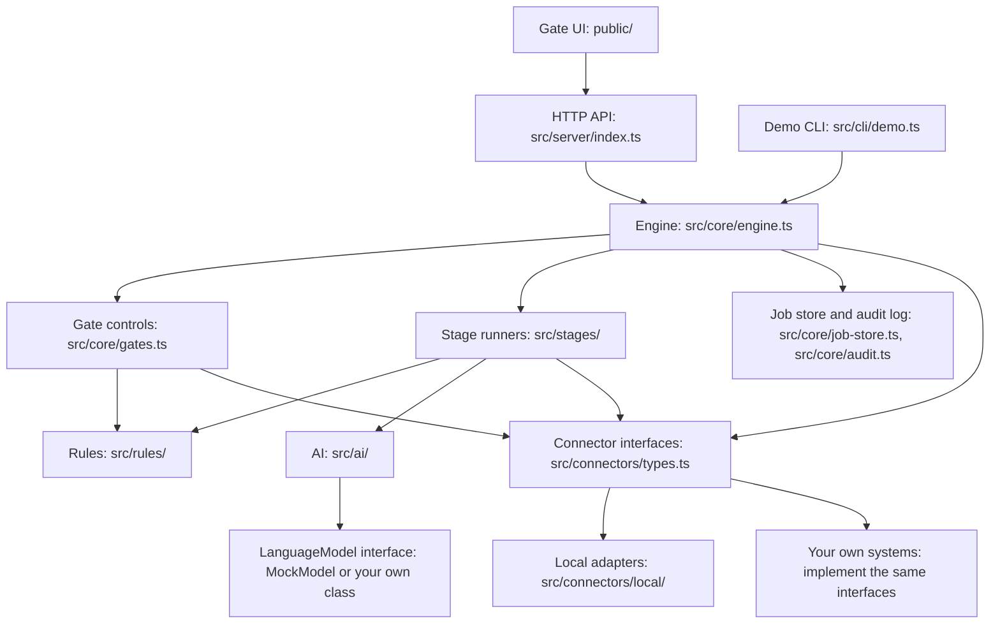

# Architecture

This document describes how the code is built. It covers the layers, the Job record, how the engine moves a request forward, where state is stored, and the limits of this reference implementation.

For the stages and gates in detail, see [workflow.md](workflow.md). For the HTTP endpoints, see [api.md](api.md).

## Layers

The code has five layers. Each layer talks only to the layer below it.



| Layer | Files | What it does |
|---|---|---|
| UI and API | [public/](../public/), [src/server/index.ts](../src/server/index.ts) | The gate UI is plain JavaScript with no build step. It calls the JSON API, and it sends no new POST while one is still running. The API is a thin wrapper over the engine. The demo CLI in [src/cli/demo.ts](../src/cli/demo.ts) calls the engine directly. |
| Engine | [src/core/engine.ts](../src/core/engine.ts), [src/core/workflow.ts](../src/core/workflow.ts), [src/core/gates.ts](../src/core/gates.ts) | The orchestrator. It runs automated stages, opens gates, applies decisions and saves the job. |
| Stages | [src/stages/](../src/stages/) | One runner per automated stage. Human gates have no runner. The registry is [src/stages/index.ts](../src/stages/index.ts). |
| Rules, AI, connectors | [src/rules/](../src/rules/), [src/ai/](../src/ai/), [src/connectors/types.ts](../src/connectors/types.ts) | Rules are pure functions that return violations. The AI layer builds prompts, calls a `LanguageModel` and fills fact slots. Connectors are interfaces to outside systems. |
| Adapters | [src/connectors/local/](../src/connectors/local/), [src/connectors/index.ts](../src/connectors/index.ts) | Local stand-ins that read sample files and write to `data/runtime`. Replace any one of them with a class that implements the same interface. |

### Connectors

The pipeline uses only the interfaces in [src/connectors/types.ts](../src/connectors/types.ts). The registry in [src/connectors/index.ts](../src/connectors/index.ts) returns the local stand-ins.

| Interface | Purpose | Local stand-in |
|---|---|---|
| `WorkspaceProvisioner` | Creates a folder and a task list for a request. | `LocalWorkspace`: writes `workspaces/{jobId}/workspace.json` |
| `ProductCatalog` | Product data: price, materials, availability. | `FileProductCatalog`: reads `data/sample/products.json` |
| `Rulebook` | Brand fact cards, tone, banned words, material lexicon, rejected phrases. | `FileRulebook`: reads `data/sample/rulebook/*.json` |
| `ChannelLibrary` | Channel specs: fields, limits, CTA policy. | `FileChannelLibrary`: reads `config/channels.json` |
| `KeywordSource` | Search keywords per brand. | `FileKeywordSource`: reads `data/sample/keywords.json` |
| `ContentStore` | Stage, preview, publish, revert and unpublish web content, with version history and a list of the versions that went live. | `LocalContentStore`: one JSON file, with a switch to simulate an outage |
| `AdExport` | Writes the bulk-upload file for an ad platform. `verify` confirms it is still delivered. | `CsvAdExport`: writes a CSV file. `verify` checks that the file exists. |
| `CreativeHandoff` | Sends approved copy to design and social production. `verify` confirms it is still delivered. | `FileCreativeHandoff`: writes a JSON file. `verify` checks that the file exists. |
| `FallbackStore` | Keeps all approved copy outside the content store. | `FileFallbackStore`: writes a JSON file |
| `Notifier` | Tells people when a gate opens or something fails. | `LogNotifier`: appends to `notifications.jsonl` and prints warnings and alerts |
| `MetricsSink` | Receives the per-request report. | `FileMetricsSink`: keeps one row per request in `metrics.jsonl` |

A connector signals that its system is down by throwing `ServiceUnavailableError`. The output stage, pre-publish QA, G4, the live check and `retryDeferred` catch this error. They mark the affected outputs as deferred or the check as a warning, and the other channels continue. Any other error is not caught.

### Language model

[src/ai/provider.ts](../src/ai/provider.ts) defines the only contract with a model:

```ts
interface LanguageModel {
  readonly id: string;
  readonly version: string;
  supportsLocale(locale: string): boolean;
  complete(request: { system: string; prompt: string }): Promise<string>;
}
```

The draft stage calls `supportsLocale` only for the optional secondary-locale draft. See [workflow.md](workflow.md#4-ai-drafts-draft).

The server and the demo use `MockModel` from [src/ai/mock-model.ts](../src/ai/mock-model.ts). To use a real language model, write a class that implements `LanguageModel` and pass it to `Engine.create`.

## The Job

The `Job` in [src/core/types.ts](../src/core/types.ts) is the single unit of state. Every stage reads and writes the Job. The engine keeps no other state about a request.

| Field | Type | Meaning |
|---|---|---|
| `id` | `string` | `job-` followed by 8 characters of a random UUID. |
| `createdAt`, `updatedAt` | ISO string | Set from the engine clock. |
| `status` | `JobStatus` | `active`, `published`, `scheduled`, `rejected` or `failed`. |
| `mode` | `RolloutMode` | `shadow`, `assisted` or `default`. Copied from `config/pipeline.json` at submit. |
| `brief` | `Brief` | The request as submitted. |
| `stages` | `Record<StageId, StageState>` | One entry per stage: `status`, `attempts`, `startedAt`, `endedAt`, `note`. |
| `workspace` | object | Folder, task list and deadline, written by stage 2. |
| `context` | `FactContext` | Brand fact card, products, channel specs, tone, keywords, banned words, material lexicon, rejected phrases. Written by stage 3. |
| `master` | object | `lockedAt`, `lockedBy` and `hash` of the brief and facts. Written when G1 approves. |
| `drafts` | `PlacementDraft[]` | Primary-locale variants per channel, and the approved `final` text, `finalSource` and `editRatio` after G2. |
| `secondary` | `SecondaryLocaleWork[]` | One entry per secondary locale: status, text direction, copy per channel, checklist, editor, history of vetoes and approvals. It can also hold an optional AI draft (`assist`) and its trace (`assistTrace`). |
| `reviewRounds` | number | Number of "changes required" decisions at G2. |
| `reviewNotes` | string[] | Notes from "changes required" at G2 and from G4 send-backs to G2. The model gets all of them on the next draft. |
| `outputs` | `OutputRecord[]` | One record per channel and locale: target, status, reference, version hash, preview URL, error. |
| `fallbackPack` | string | Path of the fallback pack file. |
| `qa` | `QaReport` | Result of pre-publish QA (7a), including the sample a person must check. |
| `publish` | object | Who published or scheduled, when, and the scheduled time. |
| `postCheck` | `QaReport` | Result of the live check (7b). |
| `report` | `JobReport` | Metrics written by stage 8. |
| `incidents` | `Incident[]` | Reverts and take-downs after publishing. |
| `counters` | `{ ruleBlocks, sendBacks }` | `ruleBlocks`: AI variants that a blocking rule stopped, including unusable model output. `sendBacks`: G4 send-backs. |

## How the engine advances

[src/core/workflow.ts](../src/core/workflow.ts) defines the 13 stages in `STAGES`. Each stage has an `id`, a `kind` (`rule`, `ai` or `human`) and an `after` list of the stages it depends on. Order lives in this list and nowhere else.

The engine has four public actions that change a job: `submit`, `decide`, `retryDeferred` and `revert`. The first three end with a call to the private `advance` method. `advance` works like this:

1. Stop if the job status is `rejected` or `failed`.
2. Find every stage whose status is `pending` and whose dependencies are all `done` or `skipped`.
3. If none is ready, stop.
4. For each ready stage, in `STAGES` order: if it is a gate, open it. If not, run its runner. Then save the job.
5. Go back to step 1. A guard stops the loop after 100 passes.
6. Save the job once more and return it.

Opening a gate sets its status to `waiting`, sends a notification to the role named in `config/pipeline.json`, and writes an audit event. The engine then does nothing more with that gate until a person decides. G3 is the exception: when the request has no secondary locale, the engine marks G3 `skipped` instead.

A runner returns one of four outcomes:

| Outcome | Effect |
|---|---|
| `done` | The stage becomes `done`. |
| `skipped` | The stage becomes `skipped`. Dependents treat it as done. |
| `retry` | The listed stages go back to `pending`. Their attempt counts are kept. The rule-check stage uses this to send failing placements back to drafting. |
| `failed` | The stage becomes `failed`, the job status changes to the given value, and a notifier alert is sent. |

A decision goes through `applyDecision` in [src/core/gates.ts](../src/core/gates.ts) first. If the decision is not valid, it throws `GateError` and the job on disk does not change. If it is valid, it changes the job, for example by closing the gate or resetting stages to `pending`. Then `advance` runs.

G2 and G3 both depend only on G1. When G1 is approved, the same `advance` call runs the draft stage and opens G3. Both gates can then be open at the same time. The output stage waits for both.

### When the job is saved

`advance` saves the job after every stage run and every gate it opens or skips, and once more when it stops. `revert` saves the job when it ends. The audit log is separate: the engine appends an audit event after every stage and every gate event.

If a runner throws an error that is not handled, the call ends with that error. The job file keeps the state from the last save, that is, the end of the previous stage or gate. Audit events and connector side effects from the failed stage, such as files or content store entries, stay in place.

### Locks

`decide`, `retryDeferred` and `revert` each run under a lock keyed by the job id (`KeyedMutex` in [src/core/mutex.ts](../src/core/mutex.ts)). Calls for the same job run one at a time, in the order they arrive. Each call loads the job from disk after it gets the lock. So when two people decide at G2 and G3 at the same moment, the second decision sees the first, and both are kept. Calls for different jobs do not wait for each other.

`submit` takes no lock, because it creates a new job. Reads (`get`, `list`, `audit`) take no lock.

`LocalContentStore` runs each load, change and save of its file under its own lock. `FileMetricsSink` does the same for `metrics.jsonl`. All of these locks are held in memory.

## Persistence

All runtime state is files under `data/runtime`. Set the `CAE_RUNTIME_DIR` environment variable to use another folder. The tests do this, so each test gets an empty folder. `npm run reset` deletes the runtime folder.

| Path under the runtime folder | Written by | Content |
|---|---|---|
| `jobs/{jobId}.json` | `JobStore` | The full Job. |
| `audit/{jobId}.jsonl` | `AuditLog` | The audit trail, one JSON object per line. |
| `content-store/entries.json` | `LocalContentStore` | All content store entries with version history. |
| `workspaces/{jobId}/workspace.json` | `LocalWorkspace` | Folder record, tasks and deadline. |
| `exports/{jobId}-ads.csv` | `CsvAdExport` | Ad bulk-upload file. |
| `handoff/{jobId}-creative.json` | `FileCreativeHandoff` | Creative hand-off package. |
| `fallback/{jobId}.json` | `FileFallbackStore` | Fallback pack with all approved copy. |
| `reports/{jobId}.md` | report stage | Human-readable report. |
| `notifications.jsonl` | `LogNotifier` | Every notification, with a time from the engine clock. |
| `metrics.jsonl` | `FileMetricsSink` | One `JobReport` per request. When the report stage runs again for a request, its row is replaced. |

JSON files are written to a temporary file with a unique name and then renamed, so a crash does not leave half a file and two writers never share a temporary file ([src/core/fsutil.ts](../src/core/fsutil.ts)). The audit log and the notification log are appended. `JobStore` in [src/core/job-store.ts](../src/core/job-store.ts) is the only class that reads and writes jobs, so you can replace it with a database class without changing the stages.

## Audit trail

[src/core/audit.ts](../src/core/audit.ts) appends one `AuditEvent` per line to `audit/{jobId}.jsonl`. The code never rewrites or deletes lines. Each event has:

| Field | Meaning |
|---|---|
| `at` | Time from the engine clock. |
| `jobId` | The job. |
| `stage` | A stage id, or `system`. |
| `actorKind` | `rule`, `ai`, `human` or `system`. |
| `actor` | `engine`, the model id, a rule set name such as `copy-rules`, or a person as "name (role)". |
| `event` | What happened. |
| `details` | Optional data, for example the stage note. |

Events the code writes:

- `request submitted`, when a brief arrives.
- `stage done`, `stage skipped`, `stage retry` or `stage failed`, after every automated stage run.
- `gate opened`, with the role that must decide.
- `decision: approve`, `decision: changes_required` and the other actions, with the note returned by the gate controls.
- `variants drafted`, once per drafted placement, with the full trace.
- `optional secondary-locale draft`, when the model drafts for a secondary locale.
- `variant blocked`, once per AI variant that fails a blocking rule, with the messages.
- `retry deferred outputs`, with the number recovered and the number held back.
- `incident: revert` or `incident: unpublish`.

`GET /api/jobs/{id}/audit` returns the trail. The UI shows it on the job page.

## Traceability

Every AI variant carries a `trace` ([src/core/types.ts](../src/core/types.ts), `Trace`). The optional secondary-locale draft carries the same fields in `assistTrace`.

| Field | Source |
|---|---|
| `promptVersion` | The `version` in the front matter of the prompt file. The default file is [prompts/draft.v1.md](../prompts/draft.v1.md) with version `draft.v1`. The path is set in `drafting.promptTemplate` in `config/pipeline.json`. |
| `modelId` | `LanguageModel.id`. For the mock model: `mock-copy-model`. |
| `modelVersion` | `LanguageModel.version`. For the mock model: `1.0.0`. |
| `inputHash` | The first 16 hex characters of a SHA-256 hash of the full prompt text and the prompt version, serialised with sorted keys ([src/core/ids.ts](../src/core/ids.ts)). |

The draft stage also writes the trace into the `variants drafted` audit event. If the model output cannot be parsed, the stage still records a variant with the trace and a blocking `output_format` violation.

Each variant keeps two copies of its text. `raw` is the model output with fact slots such as `{{product.material}}` still in place. `fields` is the text after the system filled the slots from the locked facts ([src/ai/slots.ts](../src/ai/slots.ts)). Rules and people check `fields`. A slot the system does not know becomes `[MISSING: name]`, which a rule then blocks.

At G1 the engine also stores `master.hash`, a hash of the brief and the fact context. At the output stage each output gets a `versionHash` of its approved fields. Pre-publish QA and the live check compare this hash with the content store.

## Determinism with the mock model

`MockModel` needs no network and no credentials. It reads the machine-readable `<context>` block from the prompt and picks text from fixed templates. Its answer depends only on that context: the channel, the field names, the number of variants, the CTA, the review notes, the rule feedback and the attempt number. The same prompt always gives the same variants.

The text it returns uses fact slots, not literal facts. When review notes are present, it uses a second set of templates for the homepage and CRM email channels, so a "changes required" round gives different text. `supportsLocale` returns `true` only for `en`.

`MockModel` takes an optional fault: `inventMaterial`. On the first attempt, it writes that word on the homepage instead of the material slot. The material-claim rule then blocks the variant, and the redraft loop runs. The tests and the `false-claim` demo scenario use this.

The prompt contains no time values. So the prompt hash is the same for the same brief, facts, channel, attempt number, review notes and rule feedback. Job ids and timestamps still change between runs. The tests and the demo use `SimulatedClock` from [src/core/clock.ts](../src/core/clock.ts) to control time.

## Known limits of this reference implementation

- **Single process.** The locks are held in memory. They work inside one Node.js process only. Two server processes on the same runtime folder can overwrite each other's job files and content store entries.
- **File storage.** Jobs are one JSON file each, and `list` reads every file. The local content store reads and rewrites one file on every change. The metrics sink rewrites `metrics.jsonl` on every report. The audit file is append-only in code, but nothing protects it from a person who edits the file.
- **No authentication.** The server binds to `127.0.0.1` by default. Set `HOST` to change it. A person picks a role in the browser, and the server trusts the `actor` in each request body. That is a role check, not authentication: anyone who can reach the server can claim any role. The role checks are: the named role at each gate, and `content_manager` or `admin` for a revert. Through the API, submitting a request and retrying deferred outputs need an actor name and role, but any role is accepted. The same role, `content_manager`, decides at G2 and G4, and the code does not require two different people.
- **Partial request validation.** The server checks JSON syntax, and the presence of a brief and an actor where it needs them. The gate controls check the gate, the action, the actor and the `send_back` target. They do not check every field of a decision. A missing `selections` object at G2 is refused with a 422 that lists each placement with no copy.
- **Mock model only.** The server always uses `MockModel`. There is no retry, timeout or cost control for a real model call. The mock model supports only `en`, so the optional secondary-locale draft never appears with the mock model, even when `aiAssist` is on.
- **Rollout modes.** Only `shadow` changes behaviour: G2 then requires hand-written copy. `assisted` and `default` behave the same. `default` is a label only.
- **Local stand-ins.** A scheduled entry in the local content store is marked `scheduled`, but nothing publishes it at that time. The live check reads the stored entry, not a real web page. For ad exports and creative hand-offs, `verify` only checks that the local file exists. The link check accepts https links to the hosts in `qa.allowedLinkHosts` and does not fetch them. Notifications go only to a log file and the console.
- **Rules are English-first.** The material-claim, rejected-phrase, CTA and keyword rules run only on the primary locale. The secondary locale gets the generic rules and its own banned-word list. A native editor is the main control there.
