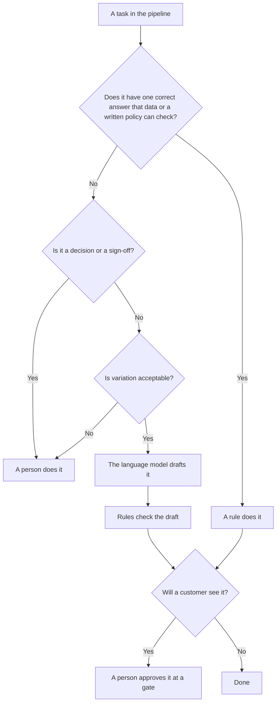

# Decision model

This page explains how the design decides who does each task in the pipeline: a rule, the language model, or a person.

The workflow records the answer for every stage. Each stage in [src/core/workflow.ts](../src/core/workflow.ts) has a `kind` of `rule`, `ai` or `human`. The audit trail records the same value as `actorKind` on every event, so you can see later who did what.

## The core rule

> If a rule can check it, a rule does it. AI drafts where variation is acceptable. A person approves anything a customer sees.

Two tests lead to this rule.

## Test 1: what kind of answer does the task have?

Ask two questions about the task.

1. **Does it have one correct answer?** A character limit, a price, a required field and a link host all have one correct answer. Data or a written policy can check it. A rule does this task.
2. **Is it a decision or a sign-off?** Accepting a brief, choosing the right register for an audience, and publishing are judgements. Someone must be accountable for them. A person does this task.

Some tasks are neither. A headline can be written many acceptable ways. The language model may draft it, because variation is fine there. Rules then check the draft for the parts that do have one correct answer.

Then ask: **will a customer see the result?** If yes, a person approves it before it goes out, even when a rule or the model produced it.

## Test 2: what does an error cost, and can it be undone?

Test 1 says who can do a task. Test 2 says how much checking the task needs around it. Put each possible error in one of four boxes.

| | Easy to undo | Hard to undo |
|---|---|---|
| **Low cost** | A draft variant fails a rule. The pipeline drafts it again with the failures as feedback, up to `maxAutoRetries` (2 in [config/pipeline.json](../config/pipeline.json)). No person sees it. | A review round spent on weak drafts. The reviewer's time is gone, but nothing reached a customer. |
| **High cost** | A wrong line on the homepage. The content store keeps every version, so a content manager can revert or take down the entry in one step (`Engine.revert` in [src/core/engine.ts](../src/core/engine.ts)). The cost is what customers saw before the revert. | A wrong price or material in a CRM email that has been sent, or a culturally wrong line in the secondary locale. The content store can revert the entry, but it cannot recall an email from an inbox or undo the harm to trust. |

How the design uses the boxes:

- **Low cost, easy to undo.** Automate fully. Rules and the redraft loop handle it without a person.
- **Low cost, hard to undo.** Reduce waste. Rules run before G2, so the reviewer only sees variants that pass.
- **High cost, easy to undo.** Check before, and keep a fast undo after. Pre-publish QA and G4 run before publishing. Version history and `revert` exist for after.
- **High cost, hard to undo.** Put a person in front of the action, with rules in front of the person. The native editor at G3 holds a veto. G4 refuses to publish while pre-publish QA has a blocking issue or while the sample is unchecked.

## Who does each task

The table covers every task in the pipeline, in workflow order. Gate roles come from `gates` in [config/pipeline.json](../config/pipeline.json).

| Task | Who | Code | Why |
|---|---|---|---|
| Check the brief: required fields, at least one product and channel, known channels, no duplicate products, channels or locales, primary locale first, configured secondary locales, valid https landing URL, valid future launch date | Rule | [src/rules/brief-rules.ts](../src/rules/brief-rules.ts), [src/stages/intake.ts](../src/stages/intake.ts) | Each check has one correct answer. A gap found here costs nothing. A failed brief gets the status `rejected`. |
| Create the workspace: a folder, a task list and a deadline of launch time minus `stageLeadHours` | Rule | [src/stages/setup.ts](../src/stages/setup.ts) | Arithmetic and a template. The `WorkspaceProvisioner` connector does the work. |
| Collect facts: products, brand fact card, channel specs, tone profile, keywords, banned words, material lexicon, rejected phrases. Check that each product exists, belongs to the brand and is available | Rule | [src/stages/gather-facts.ts](../src/stages/gather-facts.ts) | Facts come only from approved sources. The model never fetches facts. |
| Accept the brief, or reject it with a reason (G1). Approval locks the master brief with a hash | Person: content project lead | [src/core/gates.ts](../src/core/gates.ts) | A decision about message and audience. Every later step builds on it. |
| Draft copy variants for each channel in the primary locale | Language model | [src/stages/draft.ts](../src/stages/draft.ts), [src/ai/prompt.ts](../src/ai/prompt.ts) | Many wordings are acceptable, and a bad draft is cheap to redo. The model writes fact slots, so wording can vary but facts cannot. |
| Optional: draft secondary-locale copy for the native editor to start from | Language model | [src/stages/draft.ts](../src/stages/draft.ts) | Runs only when `aiAssist` is true for that locale and the model supports the locale. It is written from the locked master brief and facts, never from the primary-locale drafts. It is a starting point. The native editor still writes and approves the copy at G3. `aiAssist` is false in the sample config, and the mock model supports only `en`. |
| Fill each fact slot from approved data | Rule | [src/ai/slots.ts](../src/ai/slots.ts) | Each slot has one correct value. |
| Check every variant against the copy rules. Send failing channels back to drafting with the failures, up to `maxAutoRetries` | Rule | [src/stages/rule-checks.ts](../src/stages/rule-checks.ts), [src/rules/copy-rules.ts](../src/rules/copy-rules.ts) | These checks have one correct answer. Rules are cheap, predictable and easy to audit. |
| Select, edit and approve primary-locale copy, or send it back with "changes required" and notes (G2) | Person: content manager | [src/core/gates.ts](../src/core/gates.ts) | Customers see it, and tone is a judgement. The copy rules run again on the final text. Copy with a blocking failure cannot be approved, even after a person edits it. |
| Write secondary-locale copy from the locked master brief, and approve it or veto it (G3) | Person: native editor | [src/core/gates.ts](../src/core/gates.ts) | Transcreation is judgement, and a cultural error is high cost. The copy is cut to the channel's fields and trimmed, then the copy rules run on it. |
| Confirm that every item on the secondary-locale checklist is ticked | Rule | `secondaryChecklist` in [config/pipeline.json](../config/pipeline.json), checked in [src/core/gates.ts](../src/core/gates.ts) | The rule only checks that each item is ticked. The native editor judges each item. |
| Deliver approved copy: write the fallback pack, stage content-store entries, write the ad export file, write the creative hand-off | Rule | [src/stages/output.ts](../src/stages/output.ts) | Copying approved text has one correct answer. Nobody retypes copy. |
| Pre-publish QA: run the copy rules again, check layout direction, version, link hosts and lead time on the staged preview | Rule | [src/stages/prepublish-qa.ts](../src/stages/prepublish-qa.ts) | Checks with one correct answer, run on what will actually go out. |
| Pick the sample a person must check before publishing | Rule | [src/stages/prepublish-qa.ts](../src/stages/prepublish-qa.ts) | A fixed policy: the first `humanSampleSize` primary items, plus every secondary item up to and including the day in `secondaryFullAuditUntil`, then one secondary item. |
| Check the sample, then publish or schedule, or send the request back to G2 or G3 (G4) | Person: content manager | [src/core/gates.ts](../src/core/gates.ts) | The last point before customers see it. Some errors after this point cannot be undone. |
| Live check: confirm that each output's status and version match what was approved | Rule | [src/stages/postpublish-check.ts](../src/stages/postpublish-check.ts) | One correct answer. |
| Report times, review rounds, send-backs from G4, edit ratios, rule blocks and errors at publish | Rule | [src/stages/report.ts](../src/stages/report.ts) | Counting has one correct answer. |
| Retry outputs that were deferred while the content store was down | Person decides when, code does it | `Engine.retryDeferred` in [src/core/engine.ts](../src/core/engine.ts) | A person knows when the store is back. Re-staging and publishing approved copy has one correct answer. After G4, each recovered entry must pass the same preview checks as pre-publish QA before it goes live. |
| Revert or take down a live or scheduled entry, with a reason | Person: content manager or system owner, code does it | `Engine.revert` in [src/core/engine.ts](../src/core/engine.ts) | Removing live content is a decision. The code checks the role and requires a reason. |
| Add a rejected phrase to the negative examples and a case to the tests after an incident | Person | [data/sample/rulebook/negative-examples.json](../data/sample/rulebook/negative-examples.json), [test/rules.test.ts](../test/rules.test.ts) | A process step. No code does this. |

## What the code enforces at the gates

`applyDecision` in [src/core/gates.ts](../src/core/gates.ts) holds the controls:

- Every decision must name an actor, with a name and a role.
- Each gate accepts only its own actions. G1: approve or reject. G2: approve or "changes required". G3: approve or veto. G4: publish, schedule or send back. A send-back must go to G2 or G3.
- Only the role named for a gate can decide there, and only while the gate is open (`waiting`).
- A rejection, a "changes required", a veto and a send-back each need written notes.
- Copy is cut to the channel's own fields and trimmed before the rules run. Nobody can approve primary or secondary copy that fails a blocking copy rule.
- The secondary locale is approved only by its native editor, who can veto.
- G4 refuses to publish if pre-publish QA has not run, if it has a blocking issue, or if the sample is not marked as checked. A scheduled publish needs a future date and time.

The reference server trusts the role sent with each decision. Roles are chosen in the browser and are not authentication. A real deployment must add authentication so that the role check means something.

## Rollout modes and the manual path

`rollout` in [config/pipeline.json](../config/pipeline.json) changes who writes the primary copy, not who approves it.

- `aiDrafting: false` skips the draft stage. People write all copy at G2. The gates and rules still run.
- `mode: "shadow"` still drafts, but G2 only accepts copy that a person wrote. The drafts stay on the job for comparison in the report.
- `assisted` and `default` behave the same in the current code. A person starts from AI drafts.
