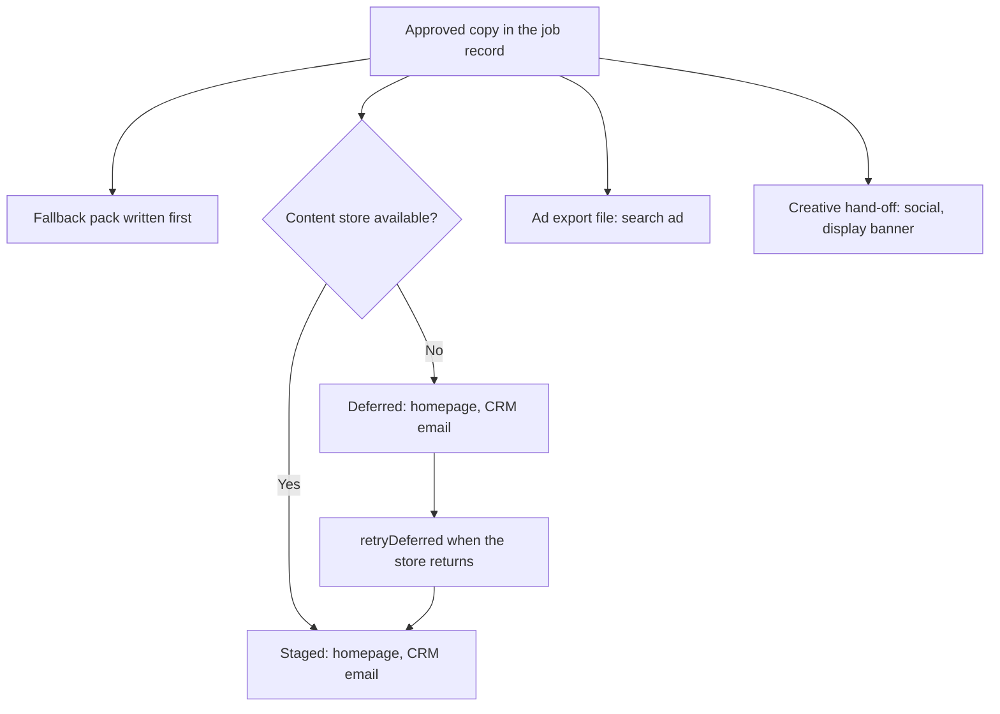

# Failure scenarios

Three runbooks for failures the design expects. Each one says what happens, how the design prevents it, what the code does, how to respond, and how to see it in the demo.

Some response steps are process steps that no code performs. Each runbook says which ones.

Run every scenario with checks, as CI does:

```bash
npm run demo -- --scenario all
```

---

## Scenario 1: a false material claim reaches the live site

### What happens

A live line says the knitwear is silk. The product record says cashmere. A customer reports it.

### How the design prevents it

- **Slots.** The model does not type materials. It writes `{{product.material}}`, and [src/ai/slots.ts](../src/ai/slots.ts) fills it from the product record.
- **The `material_claim` rule.** [src/rules/copy-rules.ts](../src/rules/copy-rules.ts) blocks any word from the material lexicon that is not a material in the product record. It runs on every primary-locale AI variant, again on the final copy at G2 (so a person's edit cannot add the word), and again in pre-publish QA.
- **The redraft loop.** A channel whose variants all fail goes back to the model with the failures in the prompt, up to `maxAutoRetries`. After that, the content manager writes the copy at G2.
- **Gates.** G2 cannot approve copy with a blocking failure. G4 needs a checked sample.

The prevention has limits, which is why this runbook exists:

- The lexicon in [data/sample/rulebook/materials.json](../data/sample/rulebook/materials.json) is a fixed list. A material that is not on the list passes the rule.
- The rule does not run on the secondary locale. See [quality-and-risk.md](quality-and-risk.md).
- The product record itself can be wrong. The rule trusts it.

### What the code does

In the demo, `MockModel` from [src/ai/mock-model.ts](../src/ai/mock-model.ts) runs with the fault `inventMaterial: 'silk'`. On the first attempt it writes the literal word "silk" in the homepage line instead of the slot.

1. The rule checks stage blocks all three homepage variants. Each block is an audit event `variant blocked` with the message `"silk" is not in the product record (record: cashmere)`.
2. The homepage is drafted again with the failures as feedback. The second attempt passes.
3. The request goes through G2, G3 and G4 and is published.
4. The incident drill calls `Engine.revert` in [src/core/engine.ts](../src/core/engine.ts) for the homepage entry in the primary locale.

`Engine.revert`:

- Allows only the `content_manager` or `admin` role, and requires a reason.
- Works only on an entry that is live or scheduled. For a staged entry it refuses, because there is nothing to revert.
- Goes back to the most recent earlier version that was live and has different copy. It writes that copy as a new version, so the history only grows (`revert`).
- If no earlier version was ever live, it takes the entry off the site (`unpublish`) and sets the output to `staged`. So a revert can never restore copy that was not live before, such as copy that was sent back at G4.
- In the demo, the homepage entry has been live in only one version, so the action is `unpublish`.
- Lists every other output of the same request, found through the job ID, in `relatedOutputs`. In the demo there are 9: the other channels and locales, including the ad export file and the creative hand-off.
- Adds an incident record to the job with the time, the person, the channel, the locale, the action, the reason and the related outputs.
- Sends an alert and writes an audit event.

The demo reverts copy that was correct, because the rule already stopped "silk". The drill exercises the response path, not a real failure.

### Response steps

1. **Take it down.** A content manager calls revert for the channel and locale with a reason. In the local app this is `POST /api/jobs/{id}/revert`. The code puts back the last earlier live copy, or takes the entry down if there is none. The code does this step.
2. **Check the related outputs.** Open each output listed in the incident. The code lists them. It does not check or fix them. The ad export file and the creative hand-off live outside the content store, so a person corrects them in the ad platform and in creative production. Process step.
3. **Find the cause.** Read the audit log for the job. The variant's trace shows the prompt version, the model and the input hash. The final placement shows whether the line was `ai-selected`, `ai-edited` or `human`. Check the product record too. Process step.
4. **Fix the source.** If the record was wrong, fix the catalogue. If the lexicon missed the word, add it to `materials.json`. Process step.
5. **Add the case.** Add the rejected phrase to [data/sample/rulebook/negative-examples.json](../data/sample/rulebook/negative-examples.json) and a test case to [test/rules.test.ts](../test/rules.test.ts). The file comment says each incident adds a case there and to the test set. No code does this. Process step.
6. **Prove the fix.** Run `npm run check` and `npm run demo -- --scenario all`.

### See it

```bash
npm run demo -- --scenario false-claim
```

---

## Scenario 2: the content store stops 2 hours before launch

### What happens

The content store stops responding 2 hours before launch. Homepage and CRM email content cannot be staged or published through it.

**The content store is where content gets published, not where it lives.** Approved copy lives in the job record and in the fallback pack. The content store is one destination among several.

### How the design prevents it

- **Lead time.** `stageLeadHours` is 48 in [config/pipeline.json](../config/pipeline.json). The setup stage sets the content deadline to launch time minus 48 hours. Pre-publish QA adds a `lead_time` warning when less than 48 hours remain. It is a warning, not a block. If the team keeps to the lead time, content is staged and scheduled two days before launch, not 2 hours before.
- **Fallback pack.** The output stage writes all approved copy for every channel and locale to a file outside the content store, before it calls the content store. Locally the file is `data/runtime/fallback/{jobId}.json`.
- **Channel independence.** The output stage handles each content-store item on its own. If the store throws `ServiceUnavailableError`, that item is marked `deferred` and the stage moves on. The ad export file and the creative hand-off do not use the content store, so they are written on time from the same approved copy.
- **Deferred, not failed.** Pre-publish QA and the live check report a deferred output as a warning, not a block. G4 skips it and publishes everything else.
- **Retry.** `Engine.retryDeferred` stages the deferred items when the store returns. After G4, it publishes each one only if it passes the same preview checks as pre-publish QA.



### What the code does

In the sample brief, homepage and CRM email go to the content store, the search ad goes to the ad export file, and social and the display banner go to the creative hand-off. Channels come from [config/channels.json](../config/channels.json).

1. [src/stages/output.ts](../src/stages/output.ts) writes the fallback pack, then tries to stage each content-store item. With the store down, 4 outputs are deferred: 2 channels in 2 locales. It sends the alert `Content store unavailable: 4 output(s) deferred. Other channels continue.` with the path of the fallback pack.
2. [src/stages/prepublish-qa.ts](../src/stages/prepublish-qa.ts) still runs every copy rule on all approved copy, because the copy comes from the job record. Each deferred output gets a warning.
3. G4 in [src/core/gates.ts](../src/core/gates.ts) skips deferred outputs and publishes the rest. If the store fails during the publish call itself, that output becomes deferred too.
4. [src/stages/postpublish-check.ts](../src/stages/postpublish-check.ts) reports each deferred output as `not live yet`.
5. `Engine.retryDeferred` in [src/core/engine.ts](../src/core/engine.ts) re-stages each deferred item from the approved copy in the job record. Items that still cannot reach the store stay deferred.
6. If G4 has already happened, it runs the same preview checks as pre-publish QA on each re-staged entry: layout direction, version and links. If a blocking check fails, the entry stays `staged` and an alert is raised. If all pass, it publishes or schedules the entry with the same action as G4.
7. When at least one item is recovered or held, it resets pre-publish QA and G4 (if G4 is still waiting) or the live check and the report (if the report is done), so they run again. The live check reports a held entry as `not live: staged, or taken down by an incident`.

Be aware of two things:

- The code marks the ad export and creative outputs `published` at G4 once their files are written. Uploading the ad file to the ad platform and posting the creative are process steps.
- `retryDeferred` reads the job record, not the fallback pack. The fallback pack is for people, if the store does not return in time.

### Response steps

1. **Confirm.** The alert names the deferred outputs and the fallback pack. The job shows each output's status.
2. **Do not hold the other channels.** The ad export file and the creative hand-off are already written from approved copy. Send them on time. Process step.
3. **Retry when the store returns.** A content manager calls `retryDeferred`. In the local app this is `POST /api/jobs/{id}/retry-deferred`. The code does this step.
4. **If the store will not return before launch,** publish the homepage and email copy from the fallback pack by another route. The pack holds the approved text, locale and text direction for every item. No code does this. Process step.
5. **Check the result.** Read the live check and the report after recovery.
6. **Review the lead time.** If the outage hit content that was not yet staged, find out why the 48-hour lead was missed. Process step.

If content was already scheduled in the store before the outage, whether it still goes live depends on the real content store. The local store in [src/connectors/local/content-store.ts](../src/connectors/local/content-store.ts) only records the schedule.

### See it

```bash
npm run demo -- --scenario outage
```

The demo stops the store after G1, well before launch. The code path is the same 2 hours before launch, plus the `lead_time` warning. To drill by hand, start the app with `CONTENT_STORE_OUTAGE=1`, or call `POST /api/drill/content-store` with `{"down": true}` and later `{"down": false}`.

---

## Scenario 3: secondary-locale copy is grammatically correct but culturally wrong

### What happens

The secondary-locale copy has no errors of grammar or spelling. But the form of address is too casual for the audience, or the line clashes with a key date or a religious sensitivity. A translation check would pass it.

### How the design prevents it

- **Transcreation, not translation.** Translation keeps the words. Transcreation keeps the intent for a different audience. The native editor writes the copy from the locked master brief (objective, audience, key message, facts and approved claims), not from the primary-locale drafts. The local server's `GET /api/jobs/{id}/master` returns exactly that, and not the drafts.
- **AI draft only on request.** By default the pipeline does not draft this locale. If `aiAssist` is true for the locale and the model supports the locale, the draft stage writes an optional AI draft from the master brief and facts, never from the primary-locale drafts. The editor can start from it with a button at G3, then rewrites and approves the copy as usual. In the sample config `aiAssist` is false, and the mock model supports only `en`, so the demo never produces one.
- **Parallel gate.** G3 depends only on G1, so it runs in parallel with G2 ([src/core/workflow.ts](../src/core/workflow.ts)). The editor does not wait for primary copy.
- **Veto.** At G3 the native editor can veto with notes. The output stage waits for G3, so a veto holds every locale: nothing in the request is delivered until every secondary locale is approved.
- **Checklist.** G3 refuses approval until every item in `secondaryChecklist` is ticked. The five items in [config/pipeline.json](../config/pipeline.json) cover register and forms of address, cultural and religious sensitivity, key dates and occasions, meaning against the master brief, and character limits.
- **Rules.** Eight copy rules run on secondary-locale copy at G3 and in pre-publish QA, including the banned words for that locale. Pre-publish QA checks that the preview renders with the right language and direction (`ar`, right to left, in the sample config).
- **100% audit until a date.** Up to and including the day in `audit.secondaryFullAuditUntil` (`2026-12-31` in the sample config), pre-publish QA puts every secondary-locale item in the sample a person must check at G4. A date without a time counts to the end of that day. After it, the sample has one secondary-locale item.
- **Native editors own the locale's tone rules.** [data/sample/rulebook/tone.json](../data/sample/rulebook/tone.json) says the secondary-locale section is written by native editors only.

Rules cannot judge cultural fit. This scenario depends on people, and the code makes sure the right person signs off.

### What the code does

1. A veto at G3 (`action: 'veto'` in [src/core/gates.ts](../src/core/gates.ts)) needs notes. It sets that locale's work to `returned`, adds the veto to its history and sends a warning. The gate stays open.
2. The output stage stays `pending` until every secondary locale is `approved`.
3. A new approval cuts the copy to each channel's own fields, trims it, and runs the copy rules and the checklist again. Approval adds an entry to the history with the editor's name.
4. At G4, the content manager can also send the request back to G3, with notes. This returns every secondary locale's work and resets output, pre-publish QA and G4. A send-back can only go to G2 or G3.
5. If the copy is already live or scheduled, `Engine.revert` works for the secondary locale too. Pass its channel and locale code.

### Response steps

1. **Before publishing:** the native editor vetoes at G3 with a note on what must change, or the content manager sends the request back to G3 from G4.
2. **After publishing:** a content manager reverts or takes down the entry for the secondary locale with `Engine.revert`. The ad export file and the creative hand-off also carry the secondary-locale copy. Correct them by hand. Process step.
3. **Record the lesson.** The native editor adds the words to the `ar` section of [data/sample/rulebook/banned-words.json](../data/sample/rulebook/banned-words.json), which G3 and pre-publish QA enforce at once. Lessons about register go in the `ar` section of `tone.json`. No code reads that section yet, so it is guidance for editors. Process step.
4. **Close the gap in the checklist.** If the error is a new class, add an item to `secondaryChecklist`. G3 then requires it. Process step.
5. **Extend the full audit.** If errors continue, move `audit.secondaryFullAuditUntil` to a later date. Process step.

### See it

```bash
npm run demo -- --scenario veto
```

The demo uses placeholder text for the secondary locale. It never generates text in that language. The native editor's text is always a person's work.
