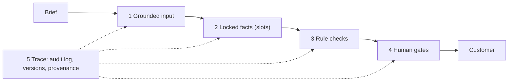

# Quality and risk

This page explains the five quality layers, maps each content risk to the layers that control it, and lists every copy rule.

## The five layers

Each layer catches what the one before it can miss. No single layer is trusted alone.

### 1. Grounded input

The brief must be complete before work starts. [src/rules/brief-rules.ts](../src/rules/brief-rules.ts) blocks a brief with gaps.

Then [src/stages/gather-facts.ts](../src/stages/gather-facts.ts) collects every input from approved sources: product records, the brand fact card, channel specs, the tone profile, keywords, banned words, the material lexicon and rejected phrases. It fails the request if a product is missing, belongs to another brand or is not available.

The language model sees only this data. The prompt template [prompts/draft.v1.md](../prompts/draft.v1.md) has seven blocks: Role, Facts, Tone, Task, Limits, Never and Output. [src/ai/prompt.ts](../src/ai/prompt.ts) fills them. The template ends with a JSON context block, so the same inputs always give the same prompt. The prompt version is stamped on every output.

### 2. Locked facts (slots)

The model never types a fact. It writes a slot such as `{{product.material}}`. After the model answers, [src/ai/slots.ts](../src/ai/slots.ts) replaces each slot with the approved value.

The available slots are `brand.name`, one `brand.*` slot for each fact on the brand fact card, `product.name`, `product.category`, `product.composition`, `product.price` and `product.material`. The `product.*` values come from the first product in the brief, except `product.material`, which joins the materials of all products. Optional filters change case: `cap`, `title` and `lower`.

Rules and people check the text after the slots are filled. The variant keeps the raw model text too, with the slots in place.

### 3. Rule checks

The copy rules in [src/rules/copy-rules.ts](../src/rules/copy-rules.ts) run four times:

1. On every primary-locale AI variant, in the rule checks stage ([src/stages/rule-checks.ts](../src/stages/rule-checks.ts)). Each variant is checked and counted once, on the attempt that produced it. Failing channels go back to drafting with the failures as feedback.
2. On the final primary copy at G2, including any edits a person made.
3. On the secondary-locale copy at G3. This includes any text the editor took from the optional AI draft, which the rule checks stage does not see.
4. On all approved copy in pre-publish QA ([src/stages/prepublish-qa.ts](../src/stages/prepublish-qa.ts)), together with preview checks on each staged entry: layout direction, version and links. The same preview checks run again on any entry recovered after G4.

At G2 and G3, the copy is first cut to the channel's own fields and trimmed. Rules see exactly the text that will go out.

A `block` result stops the copy. A `warn` result is shown but does not stop it.

### 4. Human gates

Four people approve the work. G1 accepts the brief and locks it. G2 approves primary-locale copy. G3 approves secondary-locale copy, with a veto. G4 publishes. See [decision-model.md](decision-model.md) for the controls at each gate.

### 5. Trace

Every step leaves a record:

- An append-only audit log, one JSON line per event and one file per job ([src/core/audit.ts](../src/core/audit.ts)).
- On every AI variant, and on the optional secondary-locale AI draft: the prompt version, the model id, the model version and a hash of the input.
- On the job: the hash of the master brief locked at G1, and the source of each final placement (`ai-selected`, `ai-edited` or `human`) with an edit ratio.
- On every output: a version hash. The content store keeps every version of an entry. A revert is written as a new version, so history only grows.
- A report per job with errors at publish, rule blocks, review rounds, send-backs from G4 and turnaround.

## Risks and the layers that control them

| Risk | Layers | What does the work |
|---|---|---|
| Brand tone of voice | 1, 3, 4 | The prompt carries the channel register, tone do and don't lists, and rejected phrases. Rules block banned words, rejected phrases and exclamation marks, and warn on capitals. A person judges tone at G2 and G3. Rules only catch known bad patterns. |
| Accuracy | 1, 2, 3, 4, 5 | Facts come from approved data through slots. Rules block unfilled slots and `[MISSING: ...]` markers. A person checks the meaning at G2. The trace shows where each line came from. |
| Product information | 1, 2, 3 | Gather facts checks that products exist, belong to the brand and are available. Name, category, composition and material are slots. The `material_claim` rule blocks a material word that is not in the product record. |
| Pricing | 2, 3 | Price is a slot. The `price_and_offer` rule blocks a price written code first that does not match a product record. It blocks any price written number first or with a currency symbol. It blocks discount language when the brief has no offer. A composition such as "100% cashmere" is not discount language. |
| Brand claims | 1, 3, 4 | The prompt lists the approved claims and tells the model to make no other claim. The `brand_spelling` rule checks the brand name. No rule compares free-text claims with the approved list. The person at G2 checks them. |
| Primary locale | 3, 4 | All twelve copy rules apply. The content manager approves at G2. |
| Secondary locale | 1, 3, 4 | A native editor writes from the locked master brief, optionally starting from an AI draft when `aiAssist` is on for the locale. The editor completes a checklist and holds a veto at G3. Eight copy rules apply. Pre-publish QA checks that the preview renders in the right language and direction. Every secondary item is in the human sample until the configured date. |
| Hallucination | 1, 2, 3, 4 | Facts are slots. The prompt says to write `[MISSING: ...]` instead of guessing. Rules block unknown slots, missing facts, unrecorded materials, prices that do not match the record or are not written as in the record, and unusable model output. A person approves at G2. |
| Brand safety | 3, 4 | Rules block banned words and rejected phrases. Pre-publish QA allows only https links to hosts in `qa.allowedLinkHosts`. The G3 checklist covers cultural and religious sensitivity. A person checks a sample at G4. |
| Human approval | 4, 5 | Four gates. Each needs a named actor with the gate's role, accepts only its own actions, and some actions need notes. G4 needs a checked sample and a QA result with no blocking issue. Every decision is in the audit log. |
| Version control | 5 | The prompt version, the master brief hash and a version hash per output are recorded. Pre-publish QA checks that the staged entry is the approved version. The live check confirms that what is live matches. The content store keeps every version. A revert goes back to the last earlier live copy and writes it as a new version. |

## Copy rules

All rules are in [src/rules/copy-rules.ts](../src/rules/copy-rules.ts). "All" in the locales column means the primary locale and every secondary locale.

| Rule id | What it checks | Severity | Locales |
|---|---|---|---|
| `required_fields` | Every required field of the channel has text. | block | All |
| `character_limit` | Each field fits its limit. Characters are counted as the reader sees them (grapheme clusters), not as code units. | block | All |
| `unresolved_slot` | No `{{` is left in the text, so no fact slot is unfilled. This also catches a slot with an unknown filter. | block | All |
| `missing_fact` | No `[MISSING: ...]` marker is in the text. | block | All |
| `material_claim` | Every word from the material lexicon that appears in the copy is also a material in the product record. | block | Primary only |
| `price_and_offer` | A price written as a currency code and then a number, such as `USD 495`, must match a product record price. A price written number first, such as `495 USD`, or with a symbol ($, €, £ or ¥) is always blocked, with a message to write it as in the product record. The rule knows the codes in `CURRENCY_CODES` plus the product currencies, so "SPF 50" passes. Discount language needs an offer in the brief: N% off, N off, per cent off, sale, discount, save, savings, half price, clearance and promo code. A bare percentage such as "100% cashmere" passes. | block | All |
| `cta_policy` | For channels where a CTA is required, the CTA is one of the channel's allowed CTAs. | block | Primary only |
| `brand_spelling` | Every case-insensitive match of the brand name uses the exact spelling on the brand fact card. | block | All |
| `banned_words` | No word or phrase from that locale's banned list. Whole words only. | block | All, each with its own list |
| `negative_examples` | No phrase that editors rejected before. | block | Primary only |
| `house_style` | No exclamation mark (block). No word of four or more capital letters for emphasis (warn). | block and warn | All |
| `keyword_coverage` | On keyword-led channels, at least one headline uses a keyword. In the sample, only the search ad is keyword-led. | warn | Primary only |

Two more checks produce violations outside this file. [src/rules/brief-rules.ts](../src/rules/brief-rules.ts) produces `brief` violations at intake. [src/stages/draft.ts](../src/stages/draft.ts) produces an `output_format` violation when the model's answer is not valid JSON with a `variants` array.

## `[MISSING: fact]`

`[MISSING: fact]` is how the system shows an honest gap instead of a guess. It appears in two ways:

1. **The model writes it.** The Facts block of the prompt says: if you need a fact that is not listed, write `[MISSING: name of the fact]`.
2. **The slot filler writes it.** If the model uses a slot name that has no approved value, `resolveSlots` replaces it with `[MISSING: slot.name]`.

The `missing_fact` rule blocks any text with the marker. In the rule checks stage, the channel goes back to drafting. If it still fails after `maxAutoRetries`, the content manager sees the failure at G2 and must write the copy with the real fact. G2 runs the rules again on the final text, so the marker cannot be approved.

A visible gap costs a few minutes. A guessed fact that looks right can reach a customer.

## Why the material lexicon applies only to the primary locale

The `material_claim` rule returns no violations when `primary` is false. There are four reasons.

1. **The lexicon is one list of English words.** [data/sample/rulebook/materials.json](../data/sample/rulebook/materials.json) has no locale, and `materialLexicon()` takes no locale. Secondary-locale copy does not contain these words, so the check would always pass and give false assurance.
2. **Matching is whole-word.** `containsTerm` in [src/rules/text.ts](../src/rules/text.ts) needs a non-letter on each side of the term. In the configured example locale, `ar` (Arabic, right to left), the definite article and some prepositions join the start of a word. A plain word list would miss those forms.
3. **Product records store materials in the primary language.** The record says `cashmere`. A correct material word in another language would never match the record, so every correct claim would be blocked.
4. **By default, the pipeline does not draft this locale.** The rule was built to catch a language model that invents a material. Secondary-locale copy comes from a native editor working from the locked master brief and its facts. The G3 checklist item "The meaning matches the locked master brief" makes fact accuracy a person's check there.

If you set `aiAssist` to true for a secondary locale and use a model that supports it, the model drafts that locale and no rule checks its materials. The native editor at G3 is then the only check on materials in that locale. Extend the rule first (see below).

Other rules also use primary-language patterns. `price_and_offer` recognises Latin-letter currency codes, four symbols and Western digits, and its discount words are English. The capitals check in `house_style` has no effect on scripts without letter case.

## How a native editor extends the rulebook for the secondary locale

Native editors own the tone rules for their locale. The rulebook files already have a section for `ar`, but today only one of them is enforced.

| File | Section | Enforced today? |
|---|---|---|
| [data/sample/rulebook/banned-words.json](../data/sample/rulebook/banned-words.json) | `ar` | Yes. G3 and pre-publish QA load the banned list for the locale. Add words and they block at once. |
| [data/sample/rulebook/tone.json](../data/sample/rulebook/tone.json) | `profiles.brand-voice.ar` | No. Gather facts loads the tone profile for the primary locale only. The section is guidance for the editor until code reads it. |
| [data/sample/rulebook/negative-examples.json](../data/sample/rulebook/negative-examples.json) | `ar` | No. Gather facts loads the primary list only, and the `negative_examples` rule skips other locales. |
| [data/sample/rulebook/materials.json](../data/sample/rulebook/materials.json) | none | No. There is no per-locale lexicon. |

To enforce more for the secondary locale:

1. The native editor writes the content: banned words, rejected phrases, tone do and don't lists, and the material terms with all their written forms.
2. An engineer changes the code:
   - Load rejected phrases per locale and remove the primary-only guard in `negative_examples`.
   - Add a per-locale material lexicon that maps each local term and its forms to the canonical material in the product record. Give `materialLexicon` a locale parameter, and compare canonical materials in `material_claim` instead of skipping the locale.
3. Add test cases for the new rules to [test/rules.test.ts](../test/rules.test.ts), written by or with the native editor.
4. Run `npm run check`.

New checklist items for G3 go in `secondaryChecklist` in [config/pipeline.json](../config/pipeline.json). G3 refuses approval until every item is ticked.
