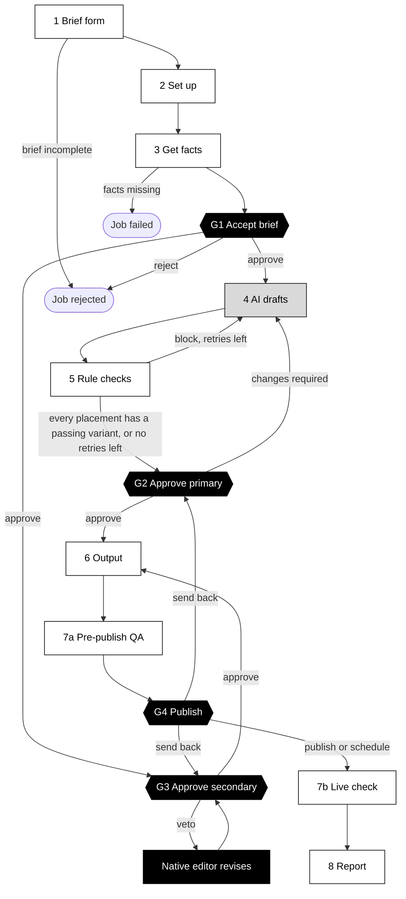
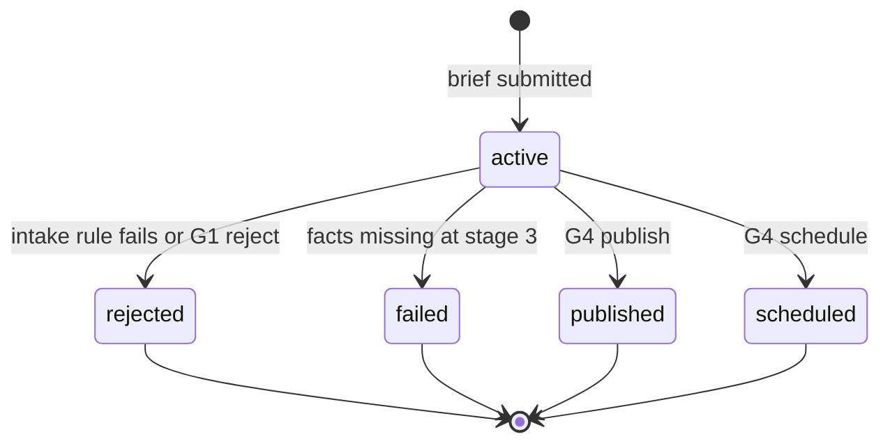
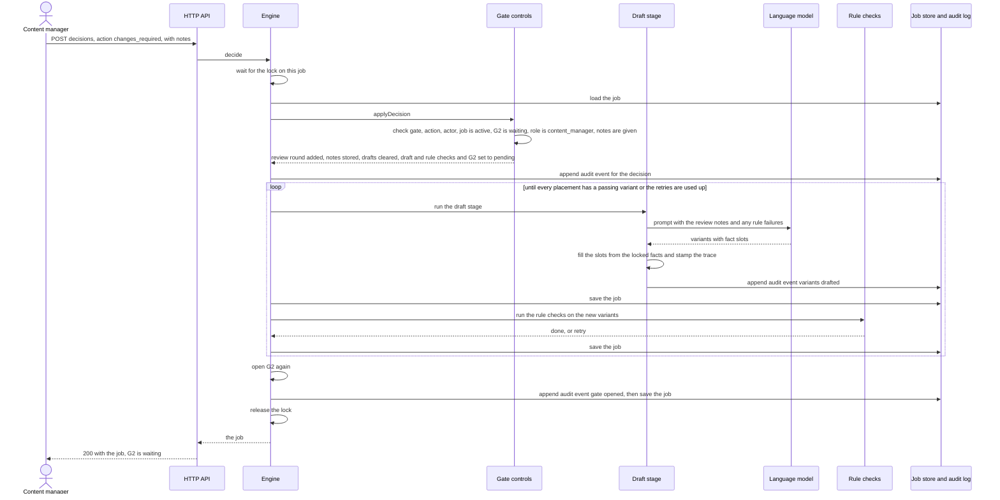

# Workflow

One brief becomes copy for several channels in two locales. The workflow has 13 stages. Rules do the checks, a language model drafts, and people decide at four gates.

The stages, their order and their dependencies are defined once, in `STAGES` in [src/core/workflow.ts](../src/core/workflow.ts). The gate controls are in [src/core/gates.ts](../src/core/gates.ts). Settings are in [config/pipeline.json](../config/pipeline.json).

## The flow

White boxes are rules. The grey box is the language model. Black boxes are people.

G2 and G3 both depend only on G1. When G1 is approved, the engine runs the draft stage and opens G3 in the same call. The native editor can work on the secondary locale while the primary copy is drafted and reviewed. The output stage starts only when both G2 and G3 are closed. Decisions on the same job are handled one at a time, so a G2 decision and a G3 decision sent at the same moment are both kept. See [architecture.md](architecture.md#locks).

## Stages

Each automated stage returns `done`, `skipped`, `retry` or `failed` to the engine. A gate has no runner: it waits for a decision. The engine saves the job after every stage and gate. See [architecture.md](architecture.md#how-the-engine-advances) for how the engine uses these outcomes.

### 1 Brief form: `intake`

[src/stages/intake.ts](../src/stages/intake.ts), rules in [src/rules/brief-rules.ts](../src/rules/brief-rules.ts)

| | |
|---|---|
| Actor kind | rule |
| Input | The brief, the channel library, the pipeline config, the current time. |
| Output | Stage `done`. The brief is complete. |
| Failure path | Any rule fails: the stage is `failed` and the job status is `rejected`. The note lists every problem. Rules: these fields are not empty: `title`, `requester`, `brandId`, `objective`, `audience`, `keyMessage`, `tone`, `launchAt`, `landingUrl`. At least one product and one channel. Every channel exists. No duplicates in `productIds`, `channels` or `locales`. The first locale is the primary locale. Every other locale is configured. The landing URL is a valid https URL. The launch date is valid and in the future. |

### 2 Set up: `setup`

[src/stages/setup.ts](../src/stages/setup.ts)

| | |
|---|---|
| Actor kind | rule |
| Input | `brief.launchAt`, `scheduling.stageLeadHours` (48). |
| Output | `job.workspace`: folder, tasks and a deadline. The deadline is the launch time minus `stageLeadHours`. The `WorkspaceProvisioner` connector creates the folder and tasks. |
| Failure path | None handled. A connector error ends the call with an error. |

### 3 Get facts: `gather_facts`

[src/stages/gather-facts.ts](../src/stages/gather-facts.ts)

| | |
|---|---|
| Actor kind | rule |
| Input | The brief. The connectors for the product catalogue, rulebook, channel library and keywords. |
| Output | `job.context` (the `FactContext`). `job.secondary`: one entry with status `waiting` for each brief locale that is not the primary locale. The text direction comes from `locales.secondary` in the config, `ltr` if not set. |
| Failure path | A product is not in the catalogue, belongs to another brand, or is not available. Or there is no brand fact card or tone profile. The stage is `failed` and the job status is `failed`. |

### G1 Accept brief: `g1_accept_brief`

[src/core/gates.ts](../src/core/gates.ts)

| | |
|---|---|
| Actor kind | human, role `content_project_lead` |
| Input | The brief and the gathered facts. |
| Output | `approve`: `job.master` is set with `lockedAt`, `lockedBy` and a hash of the brief and facts. Every later stage works from this. |
| Failure path | `reject` with notes: the gate is `failed` and the job status is `rejected`. A reject without notes is refused. |

### 4 AI drafts: `draft`

[src/stages/draft.ts](../src/stages/draft.ts), prompt in [src/ai/prompt.ts](../src/ai/prompt.ts) and [prompts/draft.v1.md](../prompts/draft.v1.md)

| | |
|---|---|
| Actor kind | ai |
| Input | The locked facts as slot names, the brief, the channel spec, the review notes so far, and the blocking violations from the last attempt. |
| Output | One `PlacementDraft` per channel in the primary locale. Each has the number of variants the channel spec asks for. Each variant has `raw` text with fact slots, `fields` with the slots filled, the attempt number and a `trace`. On a retry, only placements with no passing variant are drafted again. |
| Optional secondary-locale draft | For each secondary locale where `aiAssist` is `true` in the config and `model.supportsLocale(locale)` returns `true`, the stage also asks the model for one draft per channel from the master brief and facts, never from the primary-locale drafts. The result goes into `assist` on that locale's work, with an `assistTrace`. It runs once per locale. In the G3 view of the UI, the editor can choose "Start from the AI draft" to copy it into the form. The editor still writes and approves the copy. `aiAssist` is `false` in the shipped config, and the mock model supports only `en`. |
| Failure path | Output that is not valid JSON with a `variants` array, or a model call that throws, becomes one variant with a blocking `output_format` violation. The stage still ends `done`. For the optional secondary-locale draft, a failed channel is left out. If `rollout.aiDrafting` is `false`, the stage is `skipped` and people write the copy at G2. |

### 5 Rule checks: `rule_checks`

[src/stages/rule-checks.ts](../src/stages/rule-checks.ts), rules in [src/rules/copy-rules.ts](../src/rules/copy-rules.ts)

| | |
|---|---|
| Actor kind | rule |
| Input | The variants from the current drafting attempt. Variants from earlier attempts were checked and counted before, so they are not checked again. |
| Output | `violations` on each new variant. `counters.ruleBlocks` grows by the number of blocked variants. An `output_format` error counts as a block. Blocking rules: required fields, character limit (counted in graphemes), unfilled slot, missing fact, material claim, price and offer, CTA policy, brand spelling, banned words, rejected phrases, exclamation marks. Warnings: capitals for emphasis, no keyword in a headline on a keyword-led channel. |
| Failure path | Some placement has no passing variant and `draft.attempts` is not more than `maxAutoRetries`: the outcome is `retry`, and drafting runs again with the failures as feedback. When the retries are used up, the stage ends `done` and the reviewer at G2 sees the failures and writes that copy. With no drafts (manual path), the stage ends `done` at once. |

### G2 Approve primary: `g2_approve_primary`

[src/core/gates.ts](../src/core/gates.ts)

| | |
|---|---|
| Actor kind | human, role `content_manager` |
| Input | The primary-locale variants and their violations. |
| Output | `approve`: for every channel, a selection keyed `channel:locale`. A selection has a `variantId`, `fields`, or both. `fields` replace the variant text completely. The gate keeps only the channel's field names, trims them, and runs every copy rule again. It stores `final`, `finalSource` (`ai-selected`, `ai-edited` or `human`) and `editRatio`. `editRatio` compares the final text with the selected variant, or with the first passing AI variant when none is selected: 0 is unchanged, 1 is fully rewritten. It is not set when there is no AI variant to compare with. In shadow mode, or when AI drafting is off, `fields` are required. |
| Failure path | A missing selection, an unknown variant, or a blocking rule on the final text: the decision is refused with a `GateError` that lists each problem, and nothing changes. `changes_required` with notes: `reviewRounds` grows by 1, the notes are stored, all drafts are cleared, and `draft`, `rule_checks` and G2 go back to `pending` with their attempt counts set to 0. The model then drafts again with the notes. |

### G3 Approve secondary: `g3_approve_secondary`

[src/core/gates.ts](../src/core/gates.ts)

| | |
|---|---|
| Actor kind | human, role `native_editor` |
| Input | The locked master brief and the facts, from `GET /api/jobs/{id}/master`. Not the primary-locale drafts. The optional AI draft, when one exists. |
| Output | `approve` for one locale: copy for every channel, and the checklist. The gate keeps only each channel's field names and trims them. It runs the copy rules with that locale's banned words and requires every checklist item to be `true`. The locale work becomes `approved`. The gate closes when every secondary locale is approved. |
| Failure path | A blocking rule or an unchecked item: the decision is refused with a `GateError`. `veto` with notes: the locale work becomes `returned`, the veto goes into its history, and a warning is sent. The gate stays open, so the editor can approve later. If the request has no secondary locale, the engine marks this gate `skipped`. |

### 6 Output: `output`

[src/stages/output.ts](../src/stages/output.ts), approved copy collected by [src/core/approved.ts](../src/core/approved.ts)

| | |
|---|---|
| Actor kind | rule |
| Input | All approved copy: the primary locale from G2 and each approved secondary locale from G3. |
| Output | First, the fallback pack with all approved copy (`job.fallbackPack`). Then, by channel target: `content-store` entries are staged (status `staged`, with a preview URL); `ad-export` rows go to one CSV file (status `written`); `creative-handoff` items go to one JSON file (status `written`). Each output gets a `versionHash` of its fields. |
| Failure path | The content store throws `ServiceUnavailableError`: its outputs are `deferred` and an alert names the fallback pack. Other channels continue. The stage ends `done`. Other errors are not caught. |

### 7a Pre-publish QA: `prepublish_qa`

[src/stages/prepublish-qa.ts](../src/stages/prepublish-qa.ts)

| | |
|---|---|
| Actor kind | rule |
| Input | All approved copy and the staged content store entries. |
| Output | `job.qa`. Checks: every copy rule again on all approved copy. For each staged entry, the preview checks in `previewChecks`: the preview `lang` and `dir` match the locale and text direction, the preview carries the approved `versionHash`, and every link is https to a host in `qa.allowedLinkHosts`. A lead-time warning if launch is less than `stageLeadHours` away. A human sample: the first `qa.humanSampleSize` (2) primary placements, plus every secondary placement up to the end of the day in `audit.secondaryFullAuditUntil` (2026-12-31), and one secondary placement after that. |
| Failure path | Blocking failures are counted in `qa.blocking` and a warning is sent. The stage still ends `done`, but G4 refuses to publish. A deferred output or an unavailable preview is a warning, not a block. |

### G4 Publish: `g4_publish`

[src/core/gates.ts](../src/core/gates.ts)

| | |
|---|---|
| Actor kind | human, role `content_manager` |
| Input | `job.qa` and the human sample. |
| Output | `publish` or `schedule`: every staged content store entry is published, or scheduled for `scheduledFor`. Every ad export and creative hand-off output is marked `published` or `scheduled`. Outputs that are already `deferred` stay deferred until a retry succeeds. `job.publish` is set and the job status becomes `published` or `scheduled`. |
| Failure path | Refused if QA has not run, QA has blocking issues, `sampleChecked` is not `true`, or a schedule time is not in the future. If the content store goes down during publishing, its outputs become `deferred`. `send_back` with notes and a `to` of G2 or G3: `counters.sendBacks` grows by 1, `job.qa` is cleared, and the target gate, `output`, `prepublish_qa` and G4 go back to `pending`. To G2: the notes are added to `reviewNotes` and the approved text is cleared, but the variants stay. To G3: every secondary locale becomes `returned`. Any other target is refused. |

### 7b Live check: `postpublish_check`

[src/stages/postpublish-check.ts](../src/stages/postpublish-check.ts)

| | |
|---|---|
| Actor kind | rule |
| Input | `job.outputs`, the content store, and the ad export and creative hand-off connectors. |
| Output | `job.postCheck`. For content store outputs: the entry status matches the output status and the published version hash matches the approved hash. For ad export and creative hand-off outputs: the connector's `verify` confirms the delivery. |
| Failure path | A mismatch or a failed `verify` is blocking and sends an alert. A deferred output, a `staged` output (not live, or taken down by an incident) or a content store outage is a warning. The stage always ends `done`. Blocking failures show as "errors at publish" in the report. |

### 8 Report: `report`

[src/stages/report.ts](../src/stages/report.ts)

| | |
|---|---|
| Actor kind | rule |
| Input | The whole job. |
| Output | `job.report` (`JobReport`), sent to the metrics sink, and a markdown file at `reports/{jobId}.md`. Measures: errors at publish, rule blocks caught, review rounds, G4 send-backs, first-pass acceptance, shadow similarity, turnaround from request to publish, minutes in each stage, AI-assisted and human-written placement counts, output statuses. |
| Failure path | None handled. |

Two measures need a definition:

- **First-pass acceptance:** the share of AI-based placements with `editRatio` at or below `qa.lightEditThreshold` (0.2). It is 0 when `reviewRounds` is more than 0, because no placement was accepted in the first round. It is `null` when no placement is AI-based.
- **Shadow similarity:** for hand-written placements that have an `editRatio`, the average of 1 minus `editRatio`. 1 means the hand-written copy is the same as the AI draft. It is `null` when there is nothing to compare.

## Gates and roles

From [config/pipeline.json](../config/pipeline.json). The decision's `actor.role` must equal the gate role exactly. Any other role is refused, including `admin`.

| Gate | Label | Role id | Role label | Actions |
|---|---|---|---|---|
| `g1_accept_brief` | G1 Accept brief | `content_project_lead` | Content project lead | `approve`, `reject` |
| `g2_approve_primary` | G2 Approve primary copy | `content_manager` | Content manager | `approve`, `changes_required` |
| `g3_approve_secondary` | G3 Approve secondary-locale copy | `native_editor` | Native editor | `approve`, `veto` |
| `g4_publish` | G4 Publish | `content_manager` | Content manager | `publish`, `schedule`, `send_back` |

Before it looks at the decision itself, every gate refuses, in this order:

1. A gate id that is not one of the four.
2. An action that the gate does not accept (the `ACTIONS` map in [src/core/gates.ts](../src/core/gates.ts)).
3. A decision without an actor name and role.
4. A job whose status is not `active`.
5. A gate whose status is not `waiting`.
6. A role that is not the gate role.

The other roles in the config are `requester` and `admin` (label "System owner"). Neither decides at a gate. `admin` and `content_manager` can revert live content.

The G3 checklist has five items, all from `secondaryChecklist` in the config:

1. Register and forms of address are right for the audience
2. No cultural or religious sensitivity is broken
3. Key dates and occasions are respected
4. The meaning matches the locked master brief
5. The copy fits every character limit

## Loops and their limits

| Loop | Trigger | Limit |
|---|---|---|
| Rule checks to redraft | A placement has no variant that passes every blocking rule. | `drafting.maxAutoRetries`, set to 2. The retry runs while `draft.attempts` is 2 or less, so a placement gets at most 3 drafting attempts. After that, the reviewer writes it at G2. |
| G2 "changes required" to redraft | The content manager asks for changes. | No limit. Each round counts in `reviewRounds`. The reset sets the draft attempt count to 0, so each round gets a new set of automatic retries. |
| G3 veto | The native editor vetoes a locale. | No limit. The gate stays open and each veto is kept in the locale history. |
| G4 send back | The publisher sends the copy back to G2 or G3. | No limit. Each send-back counts in `counters.sendBacks`, not in `reviewRounds`. The output stage and pre-publish QA run again after the gate closes. |

## After G4

Two engine actions work on a published job. Both run under the per-job lock.

- **Retry deferred outputs** (`retryDeferred`). Each `deferred` content store output is staged again. Before G4, it stays `staged` and QA runs again. After G4, the entry first goes through the same `previewChecks` as pre-publish QA, and the results are added to `job.qa.checks`. If a blocking check fails, the entry stays `staged` and an alert is sent. If not, it is published or scheduled to match the G4 decision. When at least one output was recovered or held, the live check and the report run again.
- **Revert** (`revert`). Only a `content_manager` or `admin` can revert, with a reason, and only a content store entry that is live or scheduled. The engine finds the latest earlier version that went live with different copy, and puts that copy back as a new version. If no earlier version went live, it takes the entry down and sets the output to `staged`. The job gets an `Incident` that lists every other output of the request to check. The job status does not change.

## Job status

`job.status` changes only at the points below. After G4, the live check and the report still run, but the status does not change again. A later revert does not change it.

Each stage also has its own status: `pending`, `running`, `waiting` (an open gate), `done`, `failed` or `skipped`.

## A "changes required" round

If the notes are empty, or G2 is not open, or the role is wrong, the gate controls throw a `GateError`. The API returns 422 and the job does not change.
